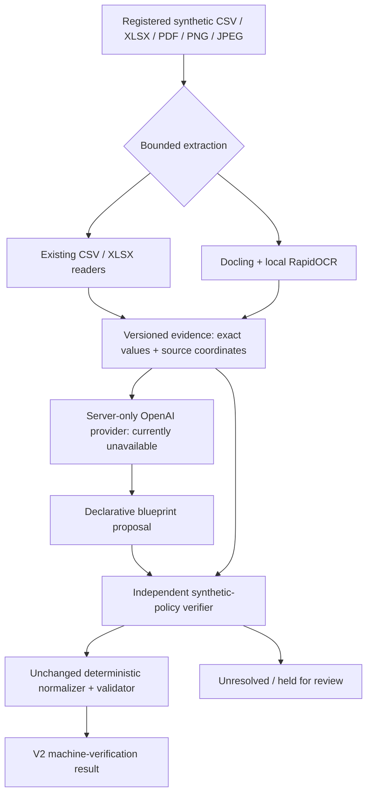

# Experimental ingestion boundary

20 October 2026. Baseline `da10e2f21add1fec5449ac32ea1affdd8024563b`; separate branch `feature/v2-multimodal-ingestion`. Existing ingestion schema/ruleset **0.1** are unchanged.

## Separation of responsibilities

`lib/ai-ingestion/contracts.ts` defines an experimental evidence, blueprint and result format, distinct from canonical schema 0.1. These V2 versions describe a local experiment, not a backend transport promise. `extract.ts` adapts existing spreadsheet readers or a replaceable Python worker. Evidence carries the exact source SHA-256, source string/typed spreadsheet value, row/column and sheet/cell or page/box coordinates. PDF boxes use top-left page points; image boxes use top-left pixels. The worker validates original page coverage and conversion success, not only surviving table pages.

`lib/server/ai-ingestion/provider.ts` owns API access. It proposes target bindings, cited literal text, date/number/monetary conventions and a small declarative operation list. It cannot execute arbitrary generated code. For PDF/images, implemented requests include original visual bytes as well as evidence. This provider has not made a live request; mocked tests prove dispatch prerequisites, not real model availability or inference quality.

`verify.ts` independently checks the proposal's schema, exact source identity and literal citations, unique source rows/targets/cells, complete populated-cell coverage, readable/full extraction, permitted operations, explicit date/number policy, source currency and source-column roles. A proposal cannot swap debit/credit or use a numeric identifier as money just because the text parses. Mixed monetary representations, unresolved assumptions, unknown column meanings or uncovered source content are held. The current column-role allowlist is an explicit **narrow synthetic policy**, not general semantic intelligence. It intentionally limits what a plausible model proposal can authorize. Template reuse must pass the same checks on fresh evidence.

Only after that gate does the adapter call the unchanged `normalizeRecord` and `validateRecord`. Exact monetary strings, leading zeros, independent dates, signed amounts versus ledger sides and source currency are preserved. `derived_ledger_net` is excluded from the V2 financial view. There is no financial total, currency conversion, reconciliation or revenue/cash-flow classification. A VERIFIED proposal can still contain rows excluded by the existing financial validator. Warning rows remain distinguishable and retain issues and source references.

## No fabricated approval or C1 result

The new output declares `approvalKind: MACHINE_VERIFICATION` under `synthetic-iso-no-defaults-0.1`. It never calls `approveMapping`, never sets `userConfirmed`, never constructs an `IngestionResult` with fictional human review, and never claims a mock mapping method. Calls to low-level normalization use empty legacy mapping metadata; V2 citations remain in their own evidence model. Internal normalization context is generated for the actual execution and is not published as C1 source lineage.

**A complete V2 → C1 bridge is not implemented.** C1/C2 public types, adapters, serializers, eligibility and reviewed `/data` approval behavior remain unchanged. Current V2 accepted test records are experimental financial projections, not downstream C1 data. Designing a new machine-approval trust boundary needs a separately reviewed integration increment; do not cast V2 results into the existing types.

## Reusable blueprints

`reuse.ts` can derive a small column-selector/settings template from a fully verified proposal with no excluded rows. It records whether its origin was LIVE_OPENAI or RECORDED_TEST. It stores no source values or old evidence IDs. Rebinding to an unseen same-layout source uses fresh values/hash/IDs, then requires full independent verification again. Changed formats/columns and missing or additional populated fields cannot silently inherit acceptance. Reuse is tested as a pure experiment; it is not persisted or automatically applied by the browser.

## Limitations and threat boundary

The six-column synthetic statement layout uses a single header per table and ISO/plain-number conventions. Merged cells, unsupported layouts, date ambiguity, missing currency assumptions, unreadable pages and partial conversions stay unresolved. Data outside extracted tables can still contain meaningful information; full document semantic coverage is not proven merely by finding a table on each page. Wider layouts require new labelled evaluation and stronger coverage policy before acceptance.

Deterministic checks establish internal consistency with extracted evidence; they **cannot prove the extractor read the pixels correctly**. The live visual comparison path is implemented but untested. Independent financial interpretation accuracy, OCR robustness under real scans, unfamiliar column semantics, multilingual documents and policy resolution remain open research work. A prompt-like-text detector is only an additional conservative hold, not a comprehensive prompt-injection defense.

The HTTP/CLI boundaries allow only controlled fixture hashes. The local server is loopback-only by launch command and rejects production/VERCEL, non-loopback Host or cross-origin requests. This is not authentication, authorization or a container sandbox. Financial content must remain synthetic. The extraction subprocess gets no application credentials. No complete records are logged as operational audit events. Full evidence is downloaded only on the local user's action and remains sensitive if future real-data support is authorized.

Budget reservations and receipts are shared by the CLI and browser, with no automatic retries or uncertain-reservation refunds. Provider-side billing/project limits are not configured because credential setup was declined. No hosted persistence, RBAC, key creation, main-branch publication or deployment occurred.
