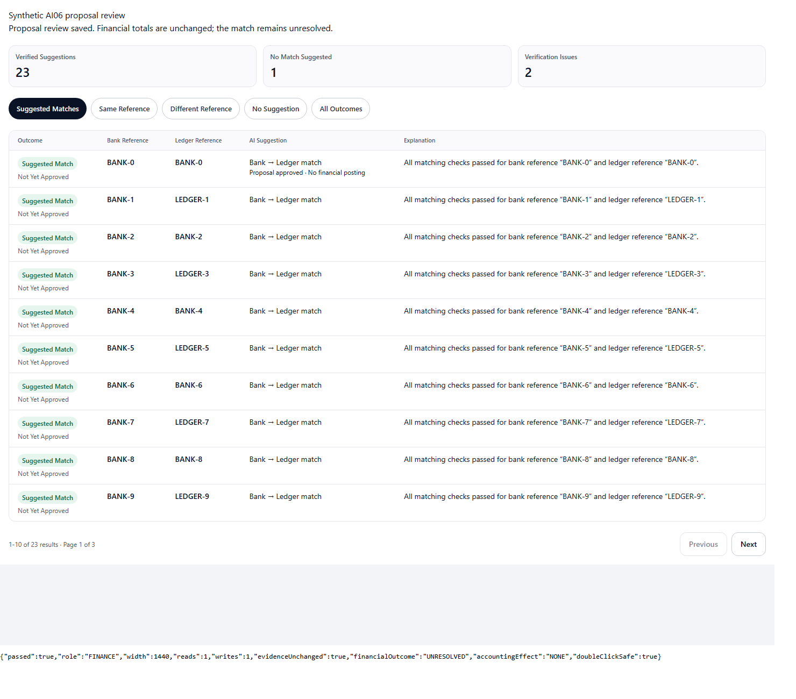
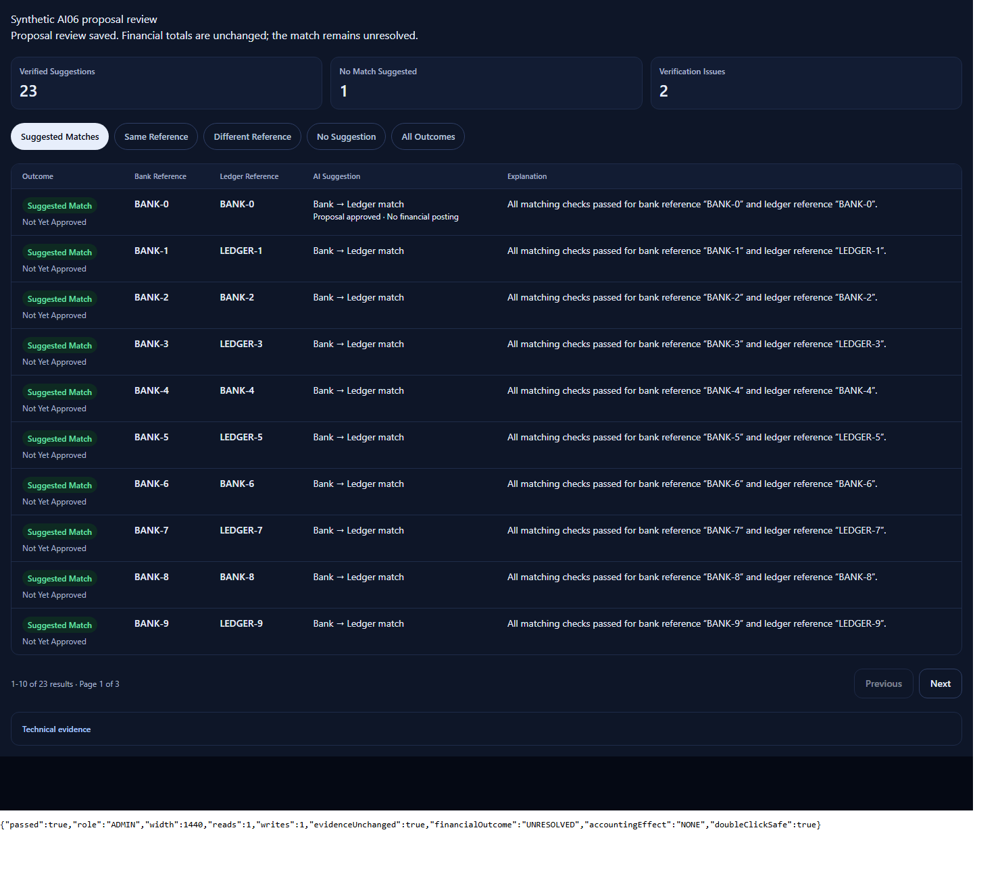
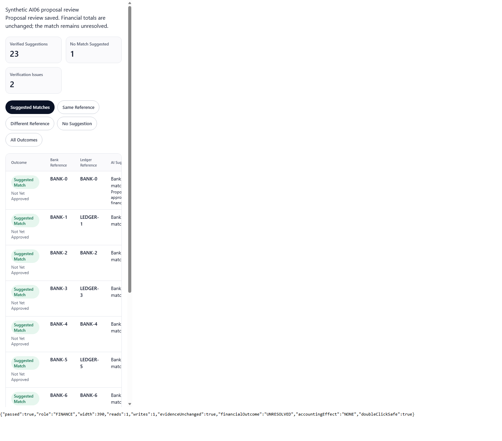

# AI06 issue 112 — final unexplained items and human proposal review

## Scope and status

Based on main `bc12453f54f597b525a5c0dc2c01a80fbbce229a`. Only AI06 integration, tests and documentation change. No shared matcher, ingestion, authentication, accounting, gateway, DB04 migration, environment or pinned fixture changes. Historical evidence stays immutable. Refs #112; this is not a claim that the Production approval walkthrough is complete.

Generation now derives eligibility from committed `DETERMINISTIC_RULES` output, including final `attention` and period items. Raw matcher exceptions alone are insufficient. Failed checks, source drift, duplicate identities, linked/resolved/timing/correcting-entry records and conflicting scope fail closed. Only final UNEXPLAINED source IDs enter the prompt. No eligible pair of sides means no model call. At most 50 candidates per side and 32 KB of prompt data; no silent truncation. Oversized candidate sets are withheld; oversized prompt bytes produce abstentions without dispatch. Claims still prevent duplicate dispatch, including failed or uncertain attempts.

The original `website-job-gpt/1` system prompt and storage envelope remain unchanged for compatibility with deployed immutable storage. New verification metadata identifies `proposalPolicy: website-unexplained/1` and `policy: website-pair-verifier/1`. The independent date limit is **two days**, stricter than the legacy `dateWithinSevenDays` field name and prompt limit. Key3-only dispatch, `structuredCompletion` → `withAiCall`, budgets, receipts and logging are unchanged. No live provider call was used in verification.

## Old experiment protections reviewed, not merged

The old `feature/ai-reconciliation-celester` commit contains no usable GPT implementation. The local `FinGence-LLM-Reconciliation` verifier, prompt, policy, identity verifier and phase2 tests were inspected directly.

| Research checks | Website adaptation |
| --- | --- |
| IDs, topology, uniqueness, BANK/LEDGER roles | Trusted final candidates; disjoint identities; one-to-one topology and assignment |
| Synthetic cohort, eligibility and provenance | Committed final rule scope, authoritative source IDs and source SHA256; no synthetic-template claim for real uploads |
| Per-side identity, transaction ID, money/date basis | Independent checks on canonical persisted pipeline records; valid signed bigint cents and canonical dates |
| Amount, direction, currency and dates | Exact signed cents/currency, same direction and at most two days |
| Reference and counterparty identity | Nonempty NFC-normalized, outer-trimmed exact references. Counterparty is **not exposed by CashSourceRow**, so no counterparty verification is claimed |
| Source claims, unique financial partner and assignment | Model supplies IDs only; references come from source records; reject any financially plausible alternative across authoritative sources and reused proposed records |

The new verifier has 26 boolean checks adapted to the website contract. They are not a claim that the research synthetic checks or unavailable counterparty check were executed. Missing/conflicting references, INV829/INV830 decoys, ambiguity, invalid dates/amounts and duplicate/unknown IDs fail independent verification. Known, structurally valid proposed pairs are independently verified one by one. Failed pairs are saved with `VERIFICATION_FAILED`, all failed check evidence and `UNRESOLVED`; they appear under Verification Issues, cannot be approved, and do not cancel valid suggestions in the same response. Unknown IDs, duplicate assignments, malformed responses and invalid abstention structure still fail the entire attempt before any evidence is saved. The Finance projection and summary classify every false check as FAIL and require all 26 checks for the new policy to show PASS. Abstentions and omissions remain supported. Prompt data is explicitly untrusted, descriptions are excluded, strict JSON refuses extra approval/score fields. The shared JSON gateway parses provider JSON before AI06 sees it; raw duplicate-key detection is not claimed. Independent validation uses the resulting IDs, not model monetary assertions.

## Human review and accounting boundary

New `/api/reconciliation/website-gpt-review` GET/POST derives organization/member from the existing verified server session. All three workspace roles review **only their own completed jobs**. POST requires same origin, bounded strict JSON, opaque expected evidence token, ordinal and UUID idempotency key. No browser ownership, roles, financial values or candidate records are accepted. Replies contain no technical financial evidence. Finance evidence projection and View as Finance remain unchanged.

Review availability is discovered only after saved evidence loads, without calling GPT. Missing SQL/runtime authorization leaves actions unavailable and preserves existing retrieval, table, five filters, explanations, ten-row pagination and bounded polling. Proposal approval/rejection is separate from accounting: **financial outcome remains UNRESOLVED, accountingEffect is NONE, and totals never change**. The UI retains Not Yet Approved for the financial match and explicitly labels reviewed proposals as having no financial posting. There is no verified atomic accounting posting interface on main; this feature does not invent one.

The SQL function independently reauthorizes the session, active member, completed own job, ingestion lineage and immutable evidence. It locks the existing job row briefly to serialize review, checks expected evidence and source records, and rechecks final UNEXPLAINED scope for approval. Old evidence lacking the new verification policy can be rejected but cannot be approved. Unique per-item decisions and request keys make decisions immutable and replay-safe. Source fingerprint/record unique indexes prevent approving a source transaction twice across jobs. The audit insert and decision are in one transaction; audit failure rolls back the decision. Explicit identical retries return the original decision and append REPLAY audit. Changed replays/conflicting decisions return conflict. There is no automatic POST or uncertain-commit retry.

## SQL installed — do not rerun

The owner confirmed installation in group Supabase `FinGence-Production`, project `zmtdozblpvtjniehwjrw`, main. The 17 November 2026 SQL Editor catalog inspection independently confirmed PostgreSQL 17.11 inside `BEGIN READ ONLY` / `ROLLBACK`:

- Installed `review()` body (normalized line endings) MD5 `d45ddaccc6a820cf1a987c94aec4af27` matches the reviewed function body, with the expected signature, postgres owner, SECURITY DEFINER and `search_path=pg_catalog`.
- `reviews` and `review_audit` have forced RLS, immutable DELETE/UPDATE/TRUNCATE triggers and tenant-bound foreign keys. The request/item uniqueness, approved BANK/LEDGER source uniqueness and UNRESOLVED constraint are present.
- The restricted login/runtime can execute `review()`. PUBLIC, anon and authenticated cannot. The login has no direct or column table privileges, inherits only the non-login runtime without admin option, and neither role has privileged flags.

Reviewed SQL file SHA256 remains `a67e4898b76983fc8ab49024a2e15e80a36780c8b0f0285740cae9814c9d8459`. Function-body equality and inspected catalog definitions are not a claim of a whole-file execution receipt. This review-fix task changes no SQL and performs no hosted inspection or writes. Do not reinstall this SQL, the storage/login SQL, or DB04 migration 005.

Remaining acceptance: authenticate on the exact PR preview and test restricted-runtime own-job suggestions, failed verification, Approve/Reject, replay, durable audit and unchanged totals using authorized synthetic data. The previous attempt was blocked by Vercel's preview access gate for `jiaqi538`; saved decision/audit rows and authenticated Production behaviour were not verified. Keep issue #112 open. Required reviews, explicit merge authorization and security/build-owner triage still apply; no review request/reply/readiness change is authorized by the 18 November fix task.

Recovery: preserve installed review/evidence/audit history. Any privilege or schema recovery requires separate owner approval. This integration records proposal review only; no accounting/source writes exist to reverse. The catalog-only SQL below is a reference for any separately authorized recheck, not an instruction to rerun installation.

```sql
BEGIN READ ONLY;
SELECT n.nspname,c.relname,c.relrowsecurity,c.relforcerowsecurity,
 has_table_privilege('fingence_ai06_website_login',c.oid,'SELECT,INSERT,UPDATE,DELETE,TRUNCATE') AS direct_access
FROM pg_class c JOIN pg_namespace n ON n.oid=c.relnamespace
WHERE n.nspname='fingence_gpt_website' AND c.relname IN ('reviews','review_audit');
-- Require exactly two rows: forced RLS true, direct_access false.
SELECT p.proname,p.prosecdef,p.proconfig,
 has_function_privilege('fingence_ai06_website_login',p.oid,'EXECUTE') AS runtime_execute,
 has_function_privilege('anon',p.oid,'EXECUTE') AS anonymous_execute
FROM pg_proc p JOIN pg_namespace n ON n.oid=p.pronamespace
WHERE n.nspname='fingence_gpt_website' AND p.proname='review';
-- Require exact reviewed signature, SECURITY DEFINER, search_path=pg_catalog,
-- runtime_execute true, anonymous_execute false; inspect constraints/triggers against reviewed SQL.
ROLLBACK;
```

## Verification evidence (2026-11-17)

- 236 focused/regression tests passed (AI06, gateway logging and deterministic reconciliation); no failures or skips in that run.
- 41 native PostgreSQL tests passed, no failures/skips, on the guarded disposable local PostgreSQL 18 cluster only. Includes FINANCE/ADMIN/SUPERADMIN own-job review, conflicting decisions, replay, cross-user/organization denial, immutable evidence/reviews, atomic audit failure rollback, stale/unsafe sources and unchanged teammate catalog definitions. Positive review uses a constructed **synthetic persisted contract fixture**, not a claim that existing deterministic rules produce that pair.
- The pinned complete pipeline resolved its sample records before GPT: no eligible final records, zero provider calls, saved empty outcomes. This expected abstention is not an authenticated live approval walkthrough.
- TypeScript (including route type generation), lint and server-boundary checks passed. The website compiled/rendered, then the build stopped with Next.js `SecurityFatalError` for the installed shared dependency. It was not bypassed or upgraded in AI06 scope. CI status is recorded in the PR after execution.
- Three local synthetic browser scenarios passed (Finance light desktop, Admin dark desktop, Finance 390px phone), including one review read, one POST despite a double click, unchanged evidence/financial state, and retained five-column/five-filter layout. Screenshots and machine-readable proof are in the ignored review ZIP; this mocked browser fixture is not Production authentication proof. No Production database access, live Groq call or Production deployment is authorized by these local results.

## Synthetic browser screenshots (mocked transport, not Production)

Light Finance desktop, dark Admin desktop and Finance phone respectively:







## Review corrections — 18 November 2026

- Retain both valid and failed pair outcomes within one immutable attempt, without weakening any of the 26 checks. Failed pairs remain UNRESOLVED and cannot be approved by the unchanged installed SQL. Structural response errors still prevent saving the entire response.
- Release a departing job's pending review state during effect cleanup. Late POST success/failure cannot disable buttons or overwrite the next job's state. Same-job duplicate prevention and explicit-retry idempotency keys are preserved.
- Review POST failures use allowlisted `REVIEW` diagnostic metadata (`REVIEW_FAILED` for unclassified errors); GET remains `READ`. No internal errors, SQL, financial data or credentials reach clients/logs. Shared model/Technical logging remains unchanged.
- Review-fix validation: 245 focused/regression tests and 42 native PostgreSQL tests passed with no failures/skips in their runs; the native mixed-outcome case saves both pairs and permits approval only for the valid pair, leaving accounting results unchanged. TypeScript/route generation, full lint and server boundaries passed. The 18 November build compiled and completed TypeScript/rendering, then again stopped with the shared Next.js `SecurityFatalError`; no dependency or security-check bypass was attempted. Final lint evidence is included in the local review correction report. No hosted acceptance or new Production success is claimed.
